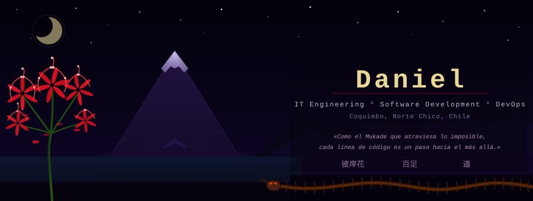
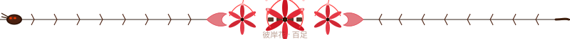

*Como el Mukade que atraviesa lo imposible...*  
*cada línea de código es un paso hacia el más allá.*

 

**Backend Development · Software Architecture · DevOps**

## About me

I'm an **Information Technology Engineering student** and software developer based in Chile, focused on building maintainable backend systems, designing APIs, and deploying containerized applications.

I work with **REST and GraphQL**, relational and NoSQL databases, and modern web architectures. I'm especially interested in **software design, CI/CD, infrastructure, and DevOps practices**.

- 🔭 **Building:** full-stack platforms, backend services, and automation workflows.
- 🛠️ **Working with:** TypeScript, NestJS, Next.js, PostgreSQL, Docker, and Podman.
- 📚 **Exploring:** system design, cloud infrastructure, observability, and deployment automation.
- 🎮 **Beyond code:** gaming, music, astronomy, and TV series.

## Tech stack

**Languages**

**Backend, frontend & APIs**

**Databases & caching**

**DevOps, infrastructure & tools**

**Engineering practices:** `OOP` · `SOLID` · `REST API Design` · `Microservices` · `CI/CD` · `Containerization`

## Selected projects

| Project | Overview | Main technologies |
| :--- | :--- | :--- |
| **📋 PROJEIC** | Project management platform with workflow methodologies and GitHub integrations. | `Next.js` `NestJS` `Nginx` |
| **🔬 MediSystem** | Clinical survey and HPV screening management platform with role-based access. | `Next.js` `NestJS` `GraphQL` `PostgreSQL` |
| **🎵 KornBeat** | Music streaming web application built with a microservices architecture. | `React` `Node.js` `MongoDB` `Redis` |
| **🌿 Guayacan Project** | Containerized e-commerce ecosystem with hybrid relational and document databases. | `React` `Node.js` `Docker` |
| **💡 Smart Lighting IoT** | ESP32-based smart lighting system using ambient light and presence sensing. | `ESP32` `C++` `MQTT` `HTTP` |

> Explore my work and technical background on my [portfolio](https://portfolio.danielduran.engineer).

## GitHub analytics

  

  <table>
    <tr>
      <td width="50%" align="center">
        
      </td>
      <td width="50%" align="center">
        
      </td>
    </tr>
    <tr>
      <td width="50%" align="center">
        
      </td>
      <td width="50%" align="center">
        
      </td>
    </tr>
  </table>

  

Dynamic cards are provided by third-party services and may be temporarily unavailable or cached. Language statistics reflect repository activity, not skill level.

## Let's connect

I'm open to conversations about **backend engineering, software architecture, DevOps, and collaborative projects**.

**Discord:** `charmandiox9`

